<a href="https://www.dahhanindustries.com"><picture><source media="(max-width: 640px)" srcset="./assets/banner-mobile.svg" /></picture></a>

<a href="https://github.com/M1D0-Technologies/dahhan-enterprises">Dahhan Enterprises</a> · <b>Dahhan Industries</b> · <a href="https://github.com/M1D0-Technologies/miss-dantella">Miss Dantella</a> · <a href="https://github.com/M1D0-Technologies/m1d0-technologies">M1D0 Technologies</a> · <a href="https://github.com/M1D0-Technologies/platform-engineering">Platform Engineering</a> · <a href="https://github.com/M1D0-Technologies">Organization</a>

# Dahhan Industries

Dahhan Industries specializes in fabrics, lace, elastics and textile accessories, supplying apparel manufacturers, lingerie producers and wholesale buyers. Rooted in the Dahhan business established in 1990, the company has particular expertise in materials for lingerie and women's underwear, while serving a broader range of textile and apparel applications.

Its capabilities span textile manufacturing, sourcing, international trade and B2B wholesale. Combining product expertise with manufacturing and supply coordination, Dahhan Industries supports the material requirements of apparel producers and commercial partners.

Within the wider Dahhan business represented internationally by Dahhan Enterprises, Dahhan Industries also supplies materials used in Miss Dantella's lingerie and nightwear collections. This relationship connects textile supply with finished-apparel production, while each business maintains its own specialization, market focus and commercial identity.

## At a glance

<picture><source media="(max-width: 640px)" srcset="./assets/glance-mobile.svg" /></picture>

## Links

<a href="https://www.dahhanindustries.com"><picture><source media="(max-width: 640px)" srcset="./assets/tiles/web-mob.svg" /></picture></a><a href="https://www.linkedin.com/company/dahhan-industries/"><picture><source media="(max-width: 640px)" srcset="./assets/tiles/li-mob.svg" /></picture></a>

Documentation and showcase material only; product source code is kept private. © 2026 Dahhan Enterprises LLC. All rights reserved.
